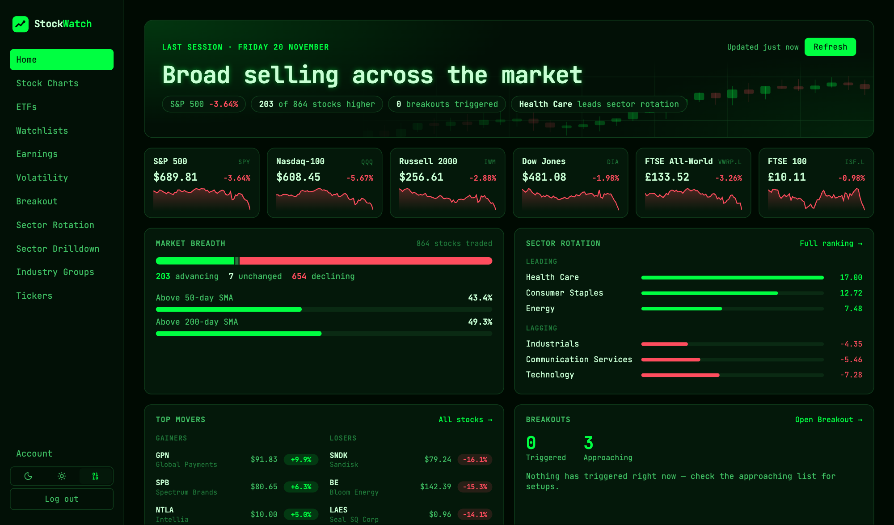

# StockWatch

A web app for screening and charting stocks against live end-of-day
data: Minervini-style breakouts, sector and industry group rotation, market
breadth, earnings and volatility. Scans run on demand.

It runs at [stockwatch.cloud](https://stockwatch.cloud), invite-only (see
[Auth](#auth)). Built with Vue 3 and Vite, an Express API on Node 24,
Postgres and [Better Auth](https://www.better-auth.com); market data comes
from Yahoo Finance.



The tracked universe is ~870 tickers: S&P 500 constituents plus the
competitors that fill out their industry groups. It's managed from the
**Tickers** page (see [Database](#database)).

## Pages

**Home** is a market dashboard: index tiles (S&P 500, Nasdaq-100,
Russell 2000, Dow, FTSE All-World, FTSE 100) with sparklines, market breadth
for the tracked universe, the leading and lagging sectors, the day's top
movers and the latest breakouts.

**Breakout** applies Mark Minervini's method. Stocks must pass his Trend
Template (stacked, rising 50/150/200-day SMAs, at least 30% off the 52-week
low, within 25% of the high). His eighth criterion, an RS Rating of 70 or
more, is switched off for now: ratings rank only the tracked tickers, so
they're shown but not filtered on.
It then looks for a volatility contraction pattern (2–6 progressively
smaller pullbacks, the last one under 10% deep on drying-up volume) in a flat
base, heartbeat, cup with handle (cup no deeper than 25%) or low cheat (a
tight pause anywhere in a cup below the handle area). The pivot is the
resistance level of the final contraction: its high, unless a few days spike
above a level price then falls back under and keeps testing. The cup's
left-side high ignores spikes the same way.
"Triggered" stocks closed above it in the last 3 trading days; cards flag
breakouts on light volume (under 40% above average) or extended more than 5%
past the pivot. "Approaching" stocks are within 5% below it. Results are
sorted by relevance and paginated.

**Sector Rotation** ranks the 11 SPDR sector ETFs by relative strength vs
SPY over 1/3/6-month windows, plus a simple money-flow
(accumulation/distribution) read, to show which sectors institutional money
is rotating into or out of. Each row links to the sector's ETF chart and its
stocks.

**Sector Drilldown** browses sector → sub-sector → stocks, with each
sector's ETF trend line and latest-day breadth for every group.

**Industry Groups** ranks industry groups by their stocks' short-term
relative strength: each stock's 1- and 3-month performance as a percentile of
the tracked universe, averaged. The top 10 groups with at least 5 rated
stocks are shown, each with its leader and closest competitors, their RS,
distance from the 52-week high, Stage 2 status and breakout setup. A ticker
can be given a custom group (e.g. Cybersecurity) on the Tickers page, ranked
in place of Yahoo's industry, which lumps groups like security software in
with the rest of software.

**Stock Charts** shows every tracked ticker as a chart card, searchable and
filterable by sector.

**Stock detail** (click any stock) has a candlestick chart with 50 and
150-day SMAs, volume and an OHLCV readout, switchable between daily, weekly
and monthly bars (weekly and monthly use 10 and 30-bar SMAs). Below it are
the breakout screen's read on the stock (pattern, pivot, base, contractions,
RS), financials (margins, free cash flow, debt/equity, P/E), trailing EPS,
a company overview and recent news.

**Earnings** lists the tracked companies reporting today and over the next 7
days, grouped by day, with each report's time (in your local time) and
whether it lands before the open, during the session, or after the close.
Dates come from Yahoo; ones a company hasn't confirmed yet are marked
"Estimated".

**Volatility** tracks the VIX alongside its 9-day and 3-month siblings and
the VVIX: today's level and how it compares with the past year, whether the
volatility curve is inverted (VIX above VIX 3-month, typical of sell-offs),
and line charts over 1 month to 1 year.

**ETFs** charts a curated list of ETFs by category. Use **Edit list** to
add, rename, recategorise or remove them. New symbols are checked against the
data provider, and their currency is looked up. The US Sectors group is
fixed: it's the 11 SPDR funds the Sector Rotation page ranks. The list lives
in the database (and so in `pnpm run db:backup`), starting from the curated
set in `src/etfs.ts` on a fresh install.

**Watchlists** let each user group stocks and ETFs into named lists and
chart them together. Create and manage them on the Watchlists page, or use
the Watchlists menu on any stock's page to add or remove it. Each account's
watchlists are private to it. A watchlist can hold any tracked ticker or
curated ETF.

**Tickers** adds, renames and removes tracked tickers, showing each one's
sector and sub-sector (looked up from Yahoo) and its custom group.

Page filters, tabs, page numbers and the chart timeframe live in the URL, so
the back button, reloads and shared links restore them. Prices show in their
trading currency (London prices quoted in pence are converted to pounds).
The app has dark, light and matrix themes.

## Setup

You'll need Node 24, pnpm 10 and Docker (or any Postgres 16).

```bash
pnpm install
pnpm --dir client install
docker compose up -d   # Postgres 16 on localhost:5432, with a stockwatch_test database for the tests
cp .env.sample .env    # then fill it in
```

Market data comes from Yahoo Finance (free, no API key needed). Everything
in `.env.sample` is optional locally: without `DATABASE_URL` the app uses the
docker compose database; without `BETTER_AUTH_SECRET` a development secret
is used (Better Auth warns about it at startup); and without Resend settings
emails (verification, password reset) are printed to the server console
instead of sent, so every flow still works. Without `ALLOWED_EMAILS`, anyone
can sign up locally; without `ADMIN_EMAILS`, nobody is an admin.

## Running

```bash
pnpm run dev
```

This starts the Express API server (port 3001) and the Vite dev server
(port 5173) together. Open `http://localhost:5173` in a browser; you'll
be prompted to sign up or log in before accessing the screens.

## Auth

Sign-in is handled by [Better Auth](https://www.better-auth.com): email and
password, plus Google and GitHub when their credentials are set. Sessions are
httpOnly cookies that last 7 days, extended while you use the app, and can
be signed out server-side.

- **Invite list:** only emails in `ALLOWED_EMAILS` can sign up or sign in
  (any method). Taking an email off the list locks that account out at its
  next sign-in. Sign-ups from other emails get the same "check your email"
  response as real ones, so the list can't be probed.
- **Welcome page and waiting list:** visitors who aren't signed in land on
  `/welcome`, which shows the features, says plainly what the site doesn't do
  (no real-time quotes, alerts or trading; not financial advice) and has a
  register-interest form. Requests are stored in `interest_requests`, emailed
  to the admins, and listed on the **Users** page. To let someone in, add them
  to `ALLOWED_EMAILS` and send an invite.
- **Privacy:** `/privacy` explains what's stored and who handles it
  (Hostinger, Resend, Google/GitHub). The only cookie is the essential
  session cookie and there are no trackers, so there's no cookie banner;
  fonts are bundled rather than loaded from Google. Update that page if
  either changes.
- **Admins:** emails in `ADMIN_EMAILS` are admins. Everyone can add tickers
  and ETFs, but only admins can edit or remove them (names, custom groups, ETF
  categories), since those change everyone's screens. Only admins see the
  **Users** page listing every account, its sign-in methods and when it was
  last active. An admin still needs to be on `ALLOWED_EMAILS` to sign in.
- **Email verification:** password accounts must verify their email before
  the first sign-in, so nobody can claim an invited address first.
- **Linking:** signing in with Google or GitHub under an existing account's
  verified email links to that account; you can also connect providers from
  the Account page.
- **Passwords** are hashed with scrypt. Resetting one (by emailed link)
  signs out every session; changing one signs out every other session.
- **Rate limiting** of the auth endpoints is on in production.

For Google and GitHub, create OAuth apps with these callback URLs (swap in
`http://localhost:5173` for local development):

- Google (Cloud Console → APIs & Services → Credentials → OAuth client ID,
  type "Web application"): `https://stockwatch.cloud/api/auth/callback/google`
- GitHub (Settings → Developer settings → OAuth Apps):
  `https://stockwatch.cloud/api/auth/callback/github`

Then set `GOOGLE_CLIENT_ID`/`GOOGLE_CLIENT_SECRET` and
`GITHUB_CLIENT_ID`/`GITHUB_CLIENT_SECRET`.

## Database

Users, sessions, watchlists, tickers and ETFs live in Postgres
(`DATABASE_URL`). The schema is migrated automatically when the server starts
(`src/migrate.ts`; `pnpm run db:migrate` runs it on its own): Better Auth's
tables, then the app's migrations, each applied once and tracked in
`schema_migrations`. Add a new migration rather than editing one that has
shipped.

- **Seeding:** the first migration seeds the tickers table from
  `src/seed/tickers.json` (every ticker with its name, sector, sub-sector,
  currency and custom group) and the ETFs from the curated list in
  `src/etfs.ts`. An existing database is never re-seeded.
- **Updating the seed:** after changing the ticker list in the app, run
  `pnpm run db:export-seed` and commit `src/seed/tickers.json` so new setups
  start from the same list. User accounts and watchlists are never exported.
- **Backups:** `pnpm run db:backup` writes a `pg_dump` snapshot to
  `data/backups/`, safe while the server is running. Restore into an empty
  database with `pg_restore --clean --if-exists --no-owner -d "$DATABASE_URL" <file>`.
  Production takes one nightly (see [deploy/README.md](deploy/README.md)).
- **Importing the old SQLite database:** `pnpm run db:import-sqlite
  [path/to/screener.db]` copies tickers and ETFs over, and adds each old
  account's watchlists to the Postgres account with the same email. Sign up
  first (passwords aren't carried over), then run it.

## Deployment

Pushes to `main` deploy to [stockwatch.cloud](https://stockwatch.cloud) once
the tests pass, through GitHub Actions (`.github/workflows/deploy.yml`). Pull
requests run the tests only. See [deploy/README.md](deploy/README.md) for how
the server is set up.

## Tests

The server tests need the docker compose Postgres (or `TEST_DATABASE_URL`);
each test file gets its own throwaway database on that server.

```bash
pnpm test               # server: indicators, screens, data, auth, watchlists
pnpm --dir client test  # client: views, components, composables
```
